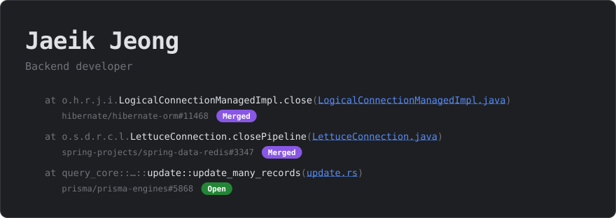
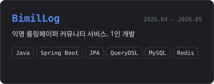
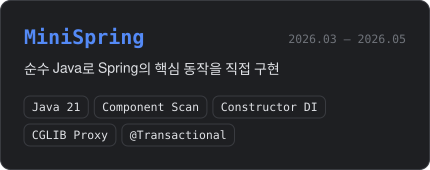
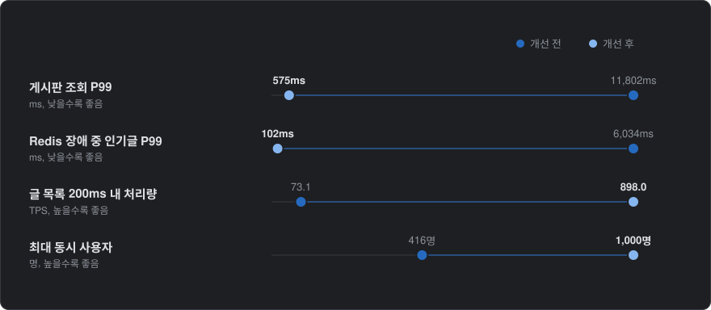

Java, Kotlin과 Spring으로 서버를 만들어 왔고, 
지금은 AI 에이전트 플랫폼의 인증과 외부 서비스 연동 권한 같은 서버 기반을 맡고 있습니다.

 

---
 

### 오픈소스 기여

| 프로젝트 | 내용 | 링크 |
|:---:|:---|:---:|
| **Hibernate ORM** 머지 | 비동기 스레드가 세션을 공유할 때 커넥션 해제 중 예외가 나면 물리 커넥션이 풀로 돌아가지 않던 누수 수정 | [PR](https://github.com/hibernate/hibernate-orm/pull/11468) [Blog](https://jaeiktech.tistory.com/76) |
| **Spring Data Redis** 머지 | 파이프라인을 닫을 때 타임아웃 같은 예외까지 다시 감싸 원인을 가리던 예외 처리 수정 | [PR](https://github.com/spring-projects/spring-data-redis/pull/3347) [Blog](https://jaeiktech.tistory.com/224) |
| **Prisma** 리뷰 중 | 외래키를 Prisma가 관리하는 설정에서 조건부 일괄 갱신이 UPDATE의 조건을 버리던 문제 수정 | [PR](https://github.com/prisma/prisma-engines/pull/5868) |

---
 

### 개인 프로젝트

<table>
  <tr>
    <td align="center" width="50%">
      
       
      <a href="https://github.com/BimilLog/BimilLog">BimilLog/BimilLog</a>
    </td>
    <td align="center" width="50%">
      
       
      <a href="https://github.com/JEONGJAEIK/MiniSpring">JEONGJAEIK/MiniSpring</a>
    </td>
  </tr>
</table>

 

**비밀로그 성능 개선**

| 원인과 조치 | 링크 |
|:---|:---:|
| **게시판 조회 P99**: 커넥션 풀 없이 쓰던 파이프라인이 요청마다 TCP 연결을 맺고 끊어 Netty 이벤트 루프의 작업 큐가 밀린 것을 찾고, 커넥션 풀 설정과 캐시 구조 변경 | [Blog](https://jaeiktech.tistory.com/224) |
| **Redis 장애 중 인기글 P99**: Redis 장애 때 로컬 캐시로 넘기는 서킷 브레이커, 정상 때 결과와의 유사도 20% → 93% | [Blog](https://jaeiktech.tistory.com/188) |
| **글 목록 처리량**: 커서 페이지네이션, 비정규화, Redis 캐시 | [Blog](https://jaeiktech.tistory.com/196) |
| **최대 동시 사용자**: Connection Refused를 OS 소켓 큐(파일 디스크립터, accept backlog)와 DB 커넥션 상한에서 찾아 조정하고, N+1 제거와 푸시 비동기화를 함께 적용 | [Blog](https://jaeiktech.tistory.com/45) |

---
 

### Tech Stack

**Language**

**Framework**

**Database & Cache**

**Infrastructure & Monitoring**

---
 

### GitHub Stats & Algorithm

---
 

### Education & Certificate

**컴퓨터공학 학사**(학점은행제) · 학점 4.5 / 4.5 
정보처리기사, 전자계산기기사, 전자계산기조직응용기사

 

